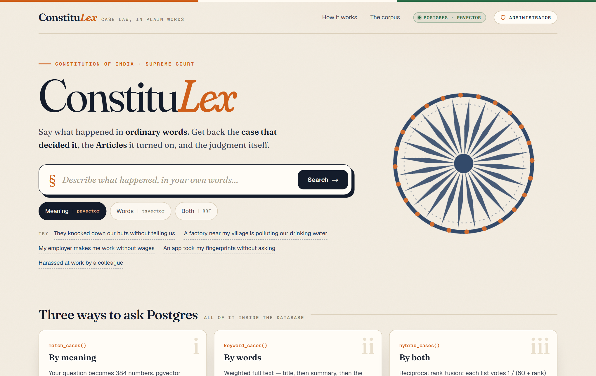
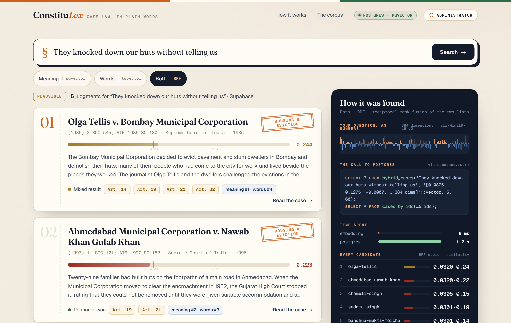
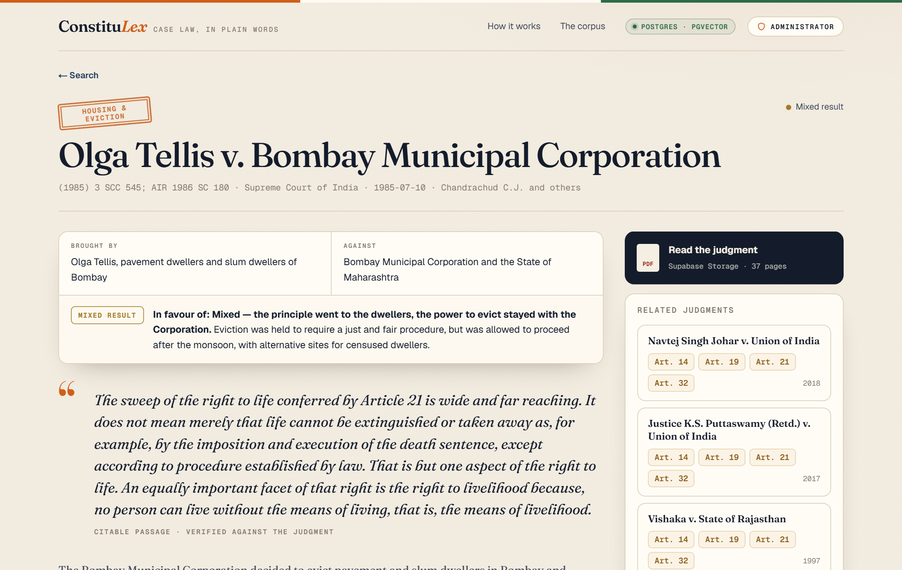
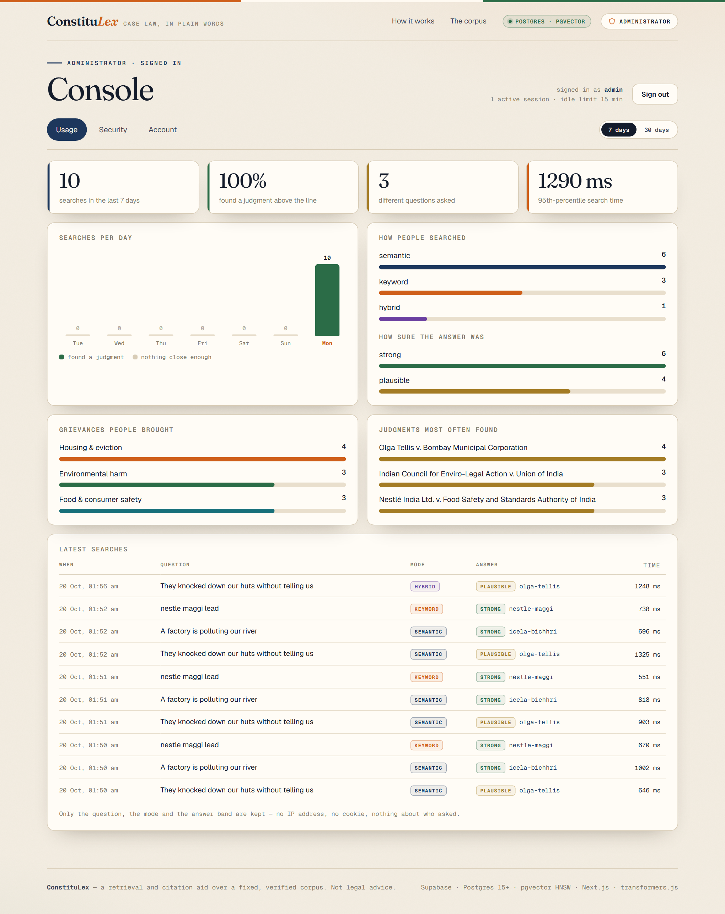

<div align="center">


# ConstituLex

**Say what happened in ordinary words. Get back the Supreme Court case that decided it,<br/>the Articles of the Constitution it turned on, and the judgment itself.**




</div>

```text
"they knocked down our huts without telling us"
  → Olga Tellis v. Bombay Municipal Corporation · (1985) 3 SCC 545 · Art. 14, 19, 21, 32
```

ConstituLex is a plain-language search over Indian constitutional case law. Every piece of retrieval — search by meaning, search by words, the fusion of the two, the links between cases, and the administrator's console — runs **inside Postgres** as SQL functions. The Next.js app only calls them and draws the answers.

> [!NOTE]
> ConstituLex is a retrieval and citation aid over a fixed, verified corpus of 30 judgments and 493 Articles. It is not legal advice.

## What it does

<table>
<tr>
<td width="50%"></td>
<td width="50%"></td>
</tr>
<tr>
<td><b>Answers, with their working shown.</b> The question drawn as a 384-bar barcode, the exact Postgres call, how long each part took, and every candidate scored against bands measured on this corpus.</td>
<td><b>The whole judgment.</b> Who brought it, who it was against, who won, a citable passage verified word for word against the PDF, the Articles in full and the cases beside it.</td>
</tr>
</table>

| | How | In the database |
|---|---|---|
| **By meaning** | The question becomes 384 numbers (`all-MiniLM-L6-v2`), compared with every judgment by cosine distance | `match_cases()` — pgvector, HNSW index |
| **By words** | Weighted full text: title 10 · summary 5 · passages 3 · keywords 1. Accent-folded, so *nestle* finds *Nestlé*; trigram fallback for misspelt names | `keyword_cases()` — `tsvector`, GIN, `unaccent`, `pg_trgm` |
| **Both** | Reciprocal rank fusion — each list votes `1 / (60 + rank)` | `hybrid_cases()` |
| **Related judgments** | Cases sharing an Article or the same kind of respondent | `related_cases()` |
| **A whole case** | The judgment, its Articles' text and its neighbours, in one call | `case_detail()` |

When nothing clears the measured threshold (0.23), the page says so plainly instead of pointing at law that does not apply.

## The administrator's console



The **Administrator** link in the top-right corner opens a sign-in page and, behind it, a console with three tabs: **Usage** (searches per day, how people searched, how sure the answers were, which grievances and judgments came up), **Security** (posture, sign-in activity, the audit log) and **Account** (change password, list of administrators).

All of it is Postgres too:

- **Passwords** are bcrypt hashes made and checked by `pgcrypto`. An unknown username costs the same time as a wrong password.
- **Five wrong attempts** pause that username for 15 minutes — counted in the database, so restarting the app does not reset it.
- **Sessions** are random 256-bit tokens in an `httpOnly`, `SameSite=Strict` cookie. Only the token's SHA-256 is stored; a session ends after 15 idle minutes or 8 hours.
- **Every sign-in, failure, lock-out and password change** goes into an audit log where each row carries the hash of the one before it. The console re-verifies the chain on every load, so an edited or deleted row shows.
- **Row level security** is on for every table. The admin tables have no policy at all, so the public key can neither read them nor call the functions that write them — only `admin_login()` and the other entry points, which check everything themselves.
- **Accounts are created from the command line only.** The website has no way to make one.

> [!IMPORTANT]
> Searches are logged for the Usage tab as the question, the mode and the answer band — no IP address, no cookie, nothing about who asked.

## Layout

```text
supabase/migrations/   the schema, every retrieval function, and the admin system
src/lib/retrieval.ts   search(), caseDetail(), corpusStats()
src/lib/admin.ts       the session cookie and the console's data
src/lib/embed.ts       query embeddings — transformers.js, same model, same 256-token limit
src/lib/db.ts          supabase.rpc() behind a one-method interface
src/lib/local.ts       the same interface over PGlite, for tests and dev:local
src/app/               the pages, the console, the server actions and the API route
tests/                 ranking parity, full text, fusion, related cases, sign-in, lock-out, sessions, audit chain (for reading)
```

## From MongoDB + Neo4j to one Postgres

The original ConstituLex split its data across two databases. Here every role lands in Postgres, and the tests hold the port to the original's behaviour: for seven recorded questions the ranking is identical to the Python engine's, and the TypeScript query embedding matches the Python one to cosine 1.000000.

| Original | Here |
|---|---|
| MongoDB `cases`, validated by `$jsonSchema` | `cases` with `CHECK` constraints, foreign keys and a `vector(384)` column |
| Embeddings in a document, cosine in NumPy | `vector(384)` with an HNSW index, ranked by `<=>` |
| MongoDB `$text` (could not fold accents) | a generated `tsvector` over accent-folded text |
| Neo4j `(:Case)-[:INVOKES]->(:Article)` | the `case_articles` join table |
| Neo4j `:RELATED_TO` | `related_cases()`, one SQL join |
| GridFS | Supabase Storage, bucket `judgments` |
| scrypt, lock-out and a hash-chained audit log in Python | the same ideas as `pgcrypto` and PL/pgSQL behind row level security |

## About this repository

This repository is published so the code can be read and inspected in full: the retrieval functions in SQL, the TypeScript that calls them, the administrator's security model and the tests. It is deliberately not a ready-to-run package. The corpus, the loading and deployment scripts and all keys are not included.

Copyright Rahul Prakaash V and Aditya Karthik. All rights reserved.
